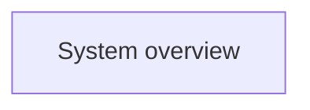

# System overview

This page is the top-level entry point for the repository's current system
truth. The diagram below is generated from document front matter; edit the
documents and run tusker check --fix instead of drawing the graph by hand.

<!-- tusker:docs-map:begin -->

<!-- tusker:docs-map:end -->
